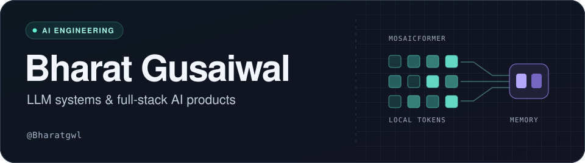

<!-- <h1 align="center">Hi 👋, I'm Bharat</h1>
<h3 align="center">Data science and ML enthusiast</h3>

- 🔭 I’m currently working on **Built and optimized RESTful APIs to facilitate seamless communication between front-end applications and databases.**

- 🌱 I’m currently learning **MCP RAG LangGraph and Agentic AI frameworks**

- 👯 I’m looking to collaborate on **ML and Data science projects**

- 🤝 I’m looking for help with **backend and Data preprocessing techniques**

- 💬 Ask me about **fullstack development and Data Science ML**

- 📫 How to reach me **Bharatgusaiwal731@gmail.com**

- ⚡ Fun fact **I am also interested in Hardware and IOT projects**

<h3 align="left">Connect with me:</h3>

<h3 align="left">Languages and Tools:</h3>

                               

 -->

  

# Bharat Gusaiwal

I build language models in PyTorch and turn AI workflows into web apps. My work spans Transformer memory, instruction fine-tuning, and products like IntelliHire, where AI-generated questions, voice interviews, and candidate feedback run in one workspace.

[**Portfolio ↗**](https://portfolio-alpha-khaki-90.vercel.app/) · [**IntelliHire ↗**](https://ai-interview-platform-two-flame.vercel.app/) · [LinkedIn](https://www.linkedin.com/in/bharat-gusaiwal/) · [Email](mailto:Bharatgusaiwal731@gmail.com)

## Featured work

### 01 · MosaicFormer

A decoder-only Transformer for exploring long-context memory in small language models. It uses local causal attention for recent tokens, compresses older chunks into learned memory vectors, and combines the two with gated fusion. The implementation includes a full-attention GPT baseline for comparison.

`PyTorch` · `Local attention` · `Learned memory` · `Ablation experiments`

[Explore MosaicFormer in my portfolio ↗](https://portfolio-alpha-khaki-90.vercel.app/#projects)

### 02 · IntelliHire

An AI interview workspace that takes a role description through question generation, shareable candidate links, voice interviews, and feedback. It also includes a coding mock-test lab, usage tracking, and subscription billing.

`Next.js` · `Supabase` · `Gemini` · `Stripe` · `Piston`

[Explore IntelliHire ↗](https://ai-interview-platform-two-flame.vercel.app/)

### 03 · Portfolio

A closer look at my LLM experiments, generative AI tools, computer vision projects, and full-stack work. It also includes my résumé and a LeetCode dashboard.

`Next.js` · `TypeScript` · `Tailwind CSS` · `Framer Motion`

[View portfolio ↗](https://portfolio-alpha-khaki-90.vercel.app/)

## LLM engineering & problem solving

- **LLM engineering** · Implemented GPT‑2 in PyTorch, fine-tuned it on Alpaca-style instructions, and evaluated responses with a local model. [GPT‑2 implementation and training pipeline](https://github.com/Bharatgwl/Finetuning-LLM-From-Scratch)
- **Data structures & algorithms** · I practice in C++, with a focus on trees, graphs, dynamic programming, and time and space complexity. [DSA for interviews](https://github.com/Bharatgwl/DSA_for_interviews) · [LeetCode](https://leetcode.com/u/Bharat_gwl/)
- **Exploring** · Retrieval-augmented generation, MCP, and agent workflows with LangGraph.

## Tech I work with

| Area | Tools & topics |
| --- | --- |
| Languages | Python, C++, TypeScript, JavaScript, SQL |
| LLMs & generative AI | PyTorch, Transformers, Hugging Face, Diffusers, SDXL, DreamBooth, LoRA, Ollama |
| AI apps & integrations | LangChain, Gemini, OpenRouter, Twilio, Piston, Stripe |
| ML, data & vision | TensorFlow, Keras, scikit-learn, Pandas, NumPy, Matplotlib, Seaborn, OpenCV, YOLO, Streamlit |
| Frontend | Next.js, React, Tailwind CSS, Framer Motion |
| Backend & databases | Flask, Django, Node.js, Express, REST APIs, Supabase, PostgreSQL, MongoDB, MySQL |
| Development & deployment | Git, GitHub, Docker, AWS, Vercel, Postman |

## Live activity

  

  

[LeetCode profile](https://leetcode.com/u/Bharat_gwl/) · [GitHub contributions](https://github.com/Bharatgwl) · [Kaggle](https://www.kaggle.com/bharatgusaiwal) · [GeeksforGeeks](https://auth.geeksforgeeks.org/user/bharatgustxex)
